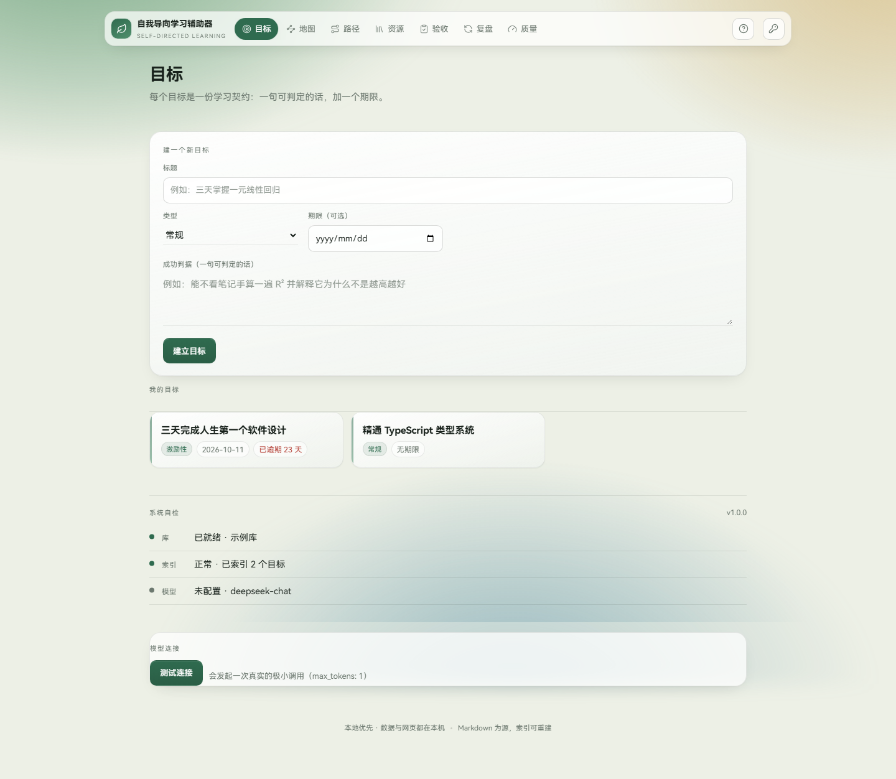
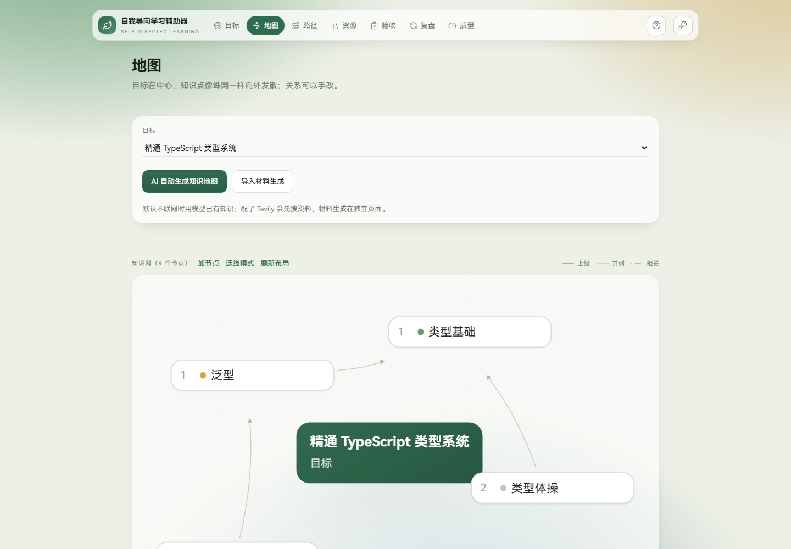
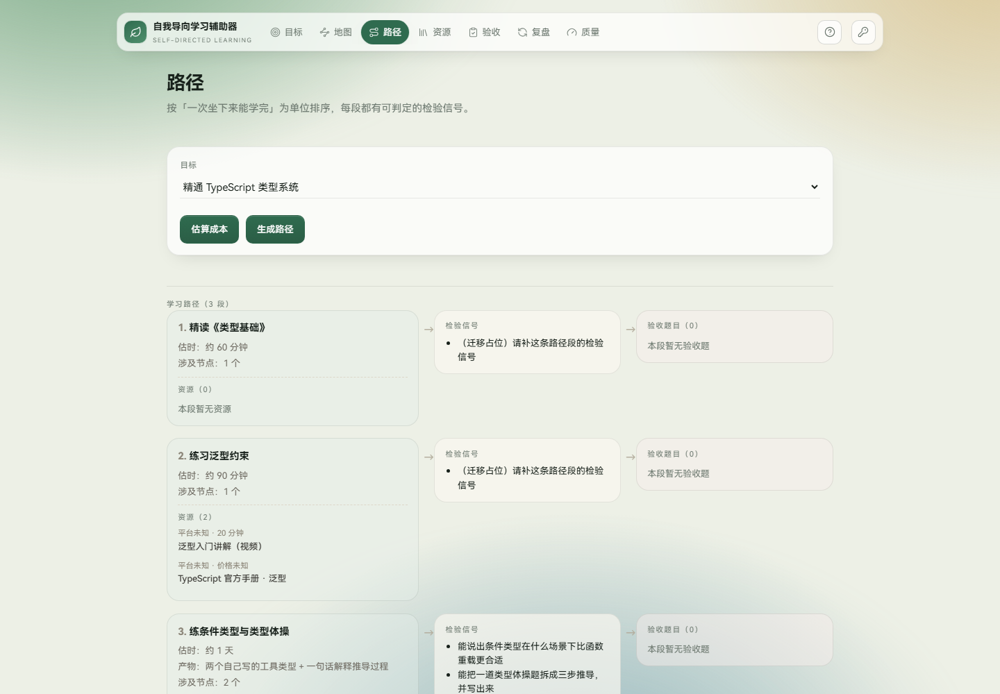
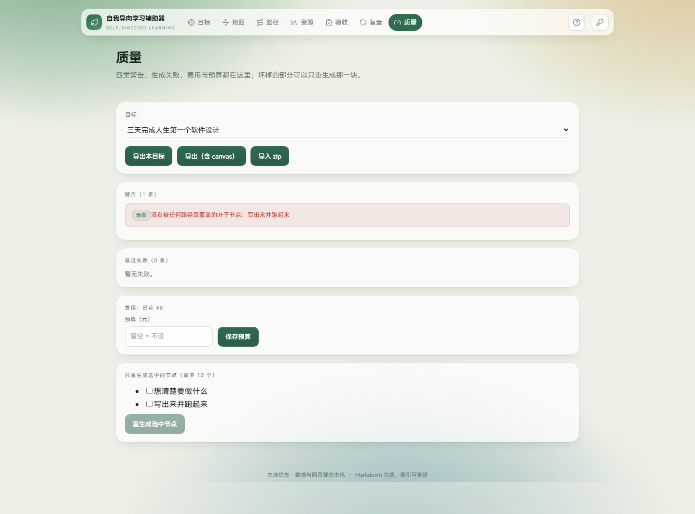

# 自我导向学习辅助器

**把一个目标运转成一条学得完的路径。**

你只给出一句可判定的目标与验收标准，它在浏览器里为你生成并维护完整的学习结构：
**知识地图 → 学习路径 → 资源 → 验收 → 复盘 → 质量检查**。数据全部是存在你本机的
Markdown 文件，不注册账号、不上传云端。

[](https://github.com/JJS-Sudo/SELF-/releases/latest)
[](https://github.com/JJS-Sudo/SELF-/releases/latest)
[](https://github.com/JJS-Sudo/SELF-/releases/latest)

Windows 下载后**双击即装**（一键安装）；免安装单文件、macOS / Linux 包与**微信传输版**
都在 [Releases](https://github.com/JJS-Sudo/SELF-/releases/latest) 页面。

> **授权：源码可见，非商业使用免费。** 本项目使用
> [PolyForm Noncommercial 1.0.0](LICENSE)：个人学习、研究、教学等非商业用途可免费使用与修改；
> **商业用途需单独授权**（联系作者微信，见文末）。它**不是** OSI 开源许可。



---

## 你需要什么

| 方式               | 需要                           | 适合                        |
| ------------------ | ------------------------------ | --------------------------- |
| **Docker（推荐）** | Docker Desktop / Docker Engine | 不想装 Node，一条命令跑起来 |
| Node               | **Node.js ≥ 22** + npm         | 想改代码、跑测试            |
| 浏览器             | Chrome / Edge / Firefox        | 使用界面                    |

不需要：数据库服务、Python、云账号。AI 生成需要你自己的 **DeepSeek API Key**（按量计费）；
可选 **Tavily Key** 用于联网检索具体资源；没有 Tavily 时会生成 B 站 / YouTube / Bing / MDN 的搜索页链接（标记「未验证」），配置后可重新补齐。

---

## 三条命令跑起来（Docker）

```bash
git clone <你的仓库地址>
cd <仓库目录>
docker compose up -d --build
```

打开 **<http://127.0.0.1:3000>** 即可。

- 首次构建约 2–4 分钟；
- 数据保存在 Docker 命名卷 `sdl_sdl-data`（容器内 `/data/vault`），删容器不丢；
- 默认只绑定 `127.0.0.1`，不会暴露到局域网。

## 或者用 Node

```bash
npm ci
npm run build
npm start
```

打开 **<http://127.0.0.1:3000>**。首次启动会自动从 `seeds/` 在仓库下创建 `vault/` 演示库；
如果你想用自己的目录，设 `SDL_VAULT_PATH` 或改 `.sdlrc.json` 的 `vaultPath`。

开发模式（前端热更新）：`npm run dev` → 网页 3000，API 3001。

## 桌面版（不想装 Node / Docker 就选这个）

从 **GitHub Releases**（或 Gitee 的镜像发行版）下载对应平台：

| 平台               | 文件                                                       |
| ------------------ | ---------------------------------------------------------- |
| Windows 10/11 x64  | `-win-x64.exe`（安装版）或 `-portable.exe`（免安装单文件） |
| macOS（universal） | `.dmg` 或 `.zip`                                           |
| Linux x64          | `.AppImage`（便携）或 `.zip`                               |

双击安装/解压即用，不需要 Node，也不需要 Docker。

- **数据目录**：安装版在系统用户目录（Windows 为 `%APPDATA%/自我导向学习辅助器/vault`）；
  免安装版（Windows portable / Linux AppImage）在程序旁 `data/vault`，整个文件夹拷走即可；
- **密钥**：桌面版用系统密钥链（safeStorage）加密保存，文件仍是库根的 `.sdl-secrets.json`；
- **更新**：安装版启动后会检查更新（GitHub 为主、Gitee 备用，失败则提示手动下载）；
- **未签名提示**：Windows SmartScreen 点「更多信息 → 仍要运行」；macOS 未公证，需右键 → 打开；
- **自己打包**：`npm run desktop:dist`（需要 C++ 构建工具，用于按 Electron ABI 重编 better-sqlite3）。

## 第一次使用

1. 首次打开会出现**欢迎弹窗**：三步说明 + Key 配置指引 + 反馈微信；
2. 在「目标」写下一个想学的东西，以及一句**可判定**的成功判据；建好后卡片「⋯」里可以编辑标题/判据/期限/状态，或删除到回收站（可恢复）；
3. 点右上角 **钥匙图标 → API Key**，填入自己的 DeepSeek Key（可选 Tavily）；
4. 去「地图」点 **AI 自动生成知识地图**，或在「路径」生成学习路径；
5. 路径确认落盘后会自动为每个节点补齐 1–2 条资源，路径页直接可点；也可以在「资源」页手动补检或删除。\n6. 之后在「验收」「复盘」「质量」里继续，随时可以改。

> Key 只保存在本机库根的 `.sdl-secrets.json`，接口只回显后 4 位，**不会进导出包**；
> 网页/Docker 版是明文文件，桌面版用系统密钥链加密；环境变量优先于页面里保存的值。

## 数据在哪里

| 运行方式   | 库位置                                                             |
| ---------- | ------------------------------------------------------------------ |
| Node       | 仓库下 `./vault`（或 `.sdlrc.json` / `SDL_VAULT_PATH` 指定的目录） |
| Docker     | 命名卷 `sdl_sdl-data`，容器内 `/data/vault`                        |
| 桌面安装版 | 系统用户目录，如 Windows `%APPDATA%/自我导向学习辅助器/vault`      |
| 桌面免安装 | Windows portable / Linux AppImage 旁 `data/vault`                  |

库就是普通文件夹：`00-配置`、`10-目标`、`20-学习项目`、`40-资源` 等，全部是 Markdown +
frontmatter，可用任何 Markdown 编辑器打开。索引 `.sdl-index.db` 是派生物，删掉会自动重建。
「质量」页可以导出整库 zip，换机器时导入即可。

## API Key 与费用

| Key      | 用途                             | 费用                                                                           |
| -------- | -------------------------------- | ------------------------------------------------------------------------------ |
| DeepSeek | 知识地图、路径、题目、资源元数据 | 按量计费；代码内置价目 ¥2/百万输入、¥8/百万输出，一次 7 节地图约 ¥0.005–0.02   |
| Tavily   | 联网检索具体资源                 | 有免费额度（约每月 1000 次，以官网为准）；不配则用平台搜索页链接兜底（未验证） |

Key 由使用者自己提供，只存在本机。没有配置时，生成类接口会返回可读错误，其余功能可用。

## 授权

- 个人学习、研究、实验、教学、公益与政府机构使用：**免费**，见 [LICENSE](LICENSE)；
- **商业用途**（含企业内部商用、收费产品、SaaS、代运营等）：需获得作者的单独商业授权；
- 商业授权、二次分发合作：微信 **`wxid_0bz0pezewo1w22`**（备注「学习辅助器」）。

> 技术手段无法阻止商用，这是一份法律许可，不是防拷贝方案。

## 反馈与问题

用起来遇到问题、想要新功能、或想反馈优化建议，加微信 **`wxid_0bz0pezewo1w22`**，
备注「学习辅助器」。也可以在仓库提 Issue。

## 截图

| 目标                               | 地图                              | 路径                               | 质量                                  |
| ---------------------------------- | --------------------------------- | ---------------------------------- | ------------------------------------- |
|  |  |  |  |

## 开发

```bash
npm run typecheck   # 根 + web 两份 tsconfig
npm run lint        # ESLint + Prettier
npm test            # Vitest（机器繁忙时可加 --maxWorkers=1 --testTimeout=30000）
npm run test:e2e    # Playwright（需先装 Chromium）
npm run snapshot -- --out ../sdl-public   # 生成可公开的干净快照
```

目录：`src/`（Hono API + 领域层 + 库写入）、`web/`（React + Vite）、`seeds/`（演示库）、
`specs/`（使命、技术栈、路线图与各阶段规格）、`tests/`、`e2e/`。

## 发布到 GitHub 与 Gitee

```bash
node scripts/public-snapshot.mjs --out ../sdl-public
cd ../sdl-public
git remote add origin <GitHub 空仓库地址>
git push -u origin main
git remote add gitee <Gitee 空仓库地址>
git push gitee main
```

快照仓库只有一个提交，不包含任何私人学习数据与密钥。

## 安全

- 默认 `HOST=127.0.0.1`，只允许本机访问；
- 监听 `0.0.0.0` 必须设置 `SDL_ACCESS_TOKEN`，否则拒绝启动；容器模式用
  `SDL_BEHIND_PROXY=1` 配合 `127.0.0.1:3000:3000` 端口映射；
- 页面保存的 key 只写本机库根，导出与导入都会排除。
